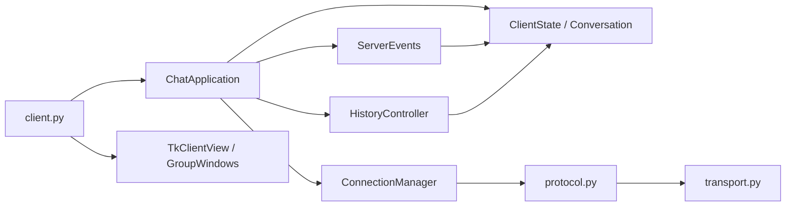
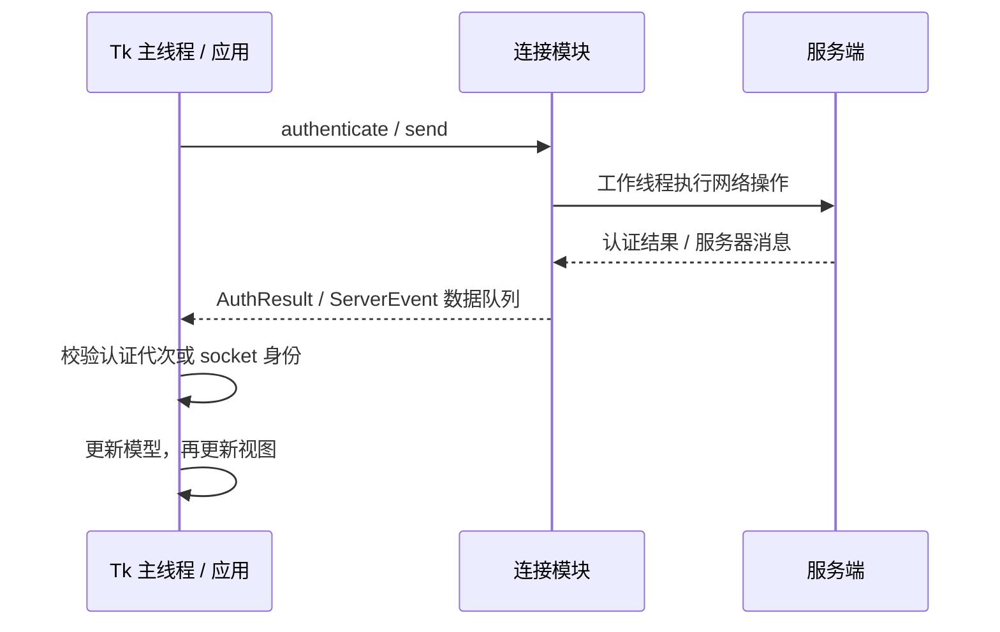

# Python 客户端结构

客户端采用组合：`ChatApplication` 协调状态、连接、历史和视图。`client.py` 负责服务器配置、创建组件和启动 Tk，不再包含业务事件分支。配置方式及 `python client.py` 启动命令不变。

## 模块与依赖

| 模块 | 负责 | 不负责 |
| --- | --- | --- |
| `client.py` | 入口、服务器地址 / 端口 / 指纹、兼容的协议函数导出 | 控件布局、线程循环、业务处理 |
| `models.py` | `ClientState`、`ChatKey`、`Conversation`、`Message` | Tk、socket、加密 |
| `connection.py` | 认证、socket、会话密钥、收发队列及线程生命周期 | 控件及业务消息的解释 |
| `protocol.py` | TCP 长度头、JSON、AES-GCM、服务器公钥校验 | 会话缓存、界面 |
| `app.py` | 用户操作、发送确认、账号草稿、事件泵及退出协调 | Tk 布局和网络读写循环 |
| `events.py` | 消息类型到处理函数的映射，更新状态并通知视图 | 后台线程及控件创建 |
| `history.py` | 请求游标、分页完成与失败重试 | 网络线程、消息气泡 |
| `view.py` / `group_view.py` | 输入、Tk 控件、消息渲染和群窗口 | 初始化账号数据、保存历史记录 |

`transport.py` 继续与 Python 服务端共用，负责协议 v2 的 HMAC、方向密钥、序号和完整帧发送锁。客户端协议没有改变。

视图接收控制器提供的操作，按模型渲染。事件和历史组件通过应用传入的接口调用视图；网络模块不导入视图。模型、连接和应用控制器均可在不加载 Tk 的情况下导入，领域测试不需要图形桌面。

## 状态归属

- `ClientState` 在应用构造时创建全部业务状态。创建或切换界面不会创建另一套好友、群聊或历史数据。
- `ChatKey('private', username)` 与 `ChatKey('group', gid)` 明确区分会话，界面框架也使用相同键。群消息不再通过 `group_messages_<gid>` 动态属性存储。
- 每个 `Conversation` 一起维护消息、排序索引、已见消息 ID、分页游标和耗尽标记。实时消息与历史消息经过同一插入 / 去重路径。
- `Message` 保存原始作者、正文、时间、服务器 ID 和发送者标记；显示前缀和气泡样式由视图决定。
- 当前连接、密钥、认证代次和线程归 `ConnectionManager`；窗口、控件和滚动回调归视图。
- 断线清除整个账号会话状态。草稿按 `(host, port, username)` 保存，使用实际连接端点，保留到同一账号重新登录。

## 线程与事件

认证线程只持有连接模块及凭据，不捕获 Tk 回调。成功认证结果由主线程接收、启用连接、创建聊天界面，再启动接收线程。取消认证会增加代次，旧结果不能替换新连接。发送队列和服务器事件都带所属 socket，重连后丢弃旧连接的数据。

主线程每轮最多处理 100 个事件，随后交还 Tk 处理键盘和窗口事件。业务事件使用显式处理表，例如 `private_chat` / `group_chat` 共用消息存储路径，群改名、转让、踢人等各有处理函数。

发送按钮生成 `request_id`，在收到服务器保存确认前保留输入。确认到达时仅清除仍与原发送文本相同的输入；失败或结果未知时不会自动重复发送。

## 历史与退出

历史请求记录发出时的游标，部分到达的消息正常去重，但不据此推进分页。只有匹配会话的 `history_end` 才完成该页；登录快照及其他会话的完成事件不会释放当前请求。退出群或被移除时同时清理对应消息、去重信息和分页状态，重新入群可重新加载。

退出顺序为：保存账号草稿、中断连接与认证、停止发送线程、等待所有线程结束、关闭尚未消费的认证 socket、由主线程销毁 Tk。视图在替换界面前取消排队的滚动回调，防止回调访问已销毁的画布。

## 维护与验证

新增服务器事件时，在 `ServerEvents.handlers` 注册处理函数，更新模型后调用视图接口。修改网络生命周期时，应在连接层验证取消、过期结果和旧连接隔离；控件变化通过真实 Tk 测试验证。避免在连接模块引入控制器 / 视图回调，避免在窗口构造函数里清空业务状态。

测试入口和命令见 [CONTRIBUTING.md](CONTRIBUTING.md)。`test_client_components.py` 不创建 Tk 窗口；`test_regressions.py` 的真实 Tk 测试覆盖选择、输入确认、滚轮、群窗口和退出；`test_history_recovery.py` 检查部分分页失败后的重试；`test_client_drafts.py` 检查账号与端点隔离；`test_go_interop.py` 包含真实客户端到 Go 服务端的登录和发送路径。

v1.0.16 在 Linux 上的完整回归为 122 项，全部通过，包含 Go 互操作和进程级可靠性测试。完整回归使用 Tk 9，另以 Tk 8.6 执行 16 项真实界面 / 草稿专项并通过；跨平台回归由发布流水线继续验证。
