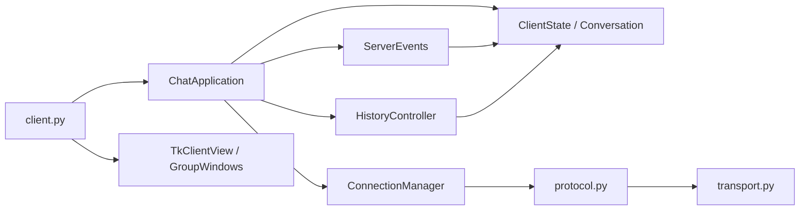
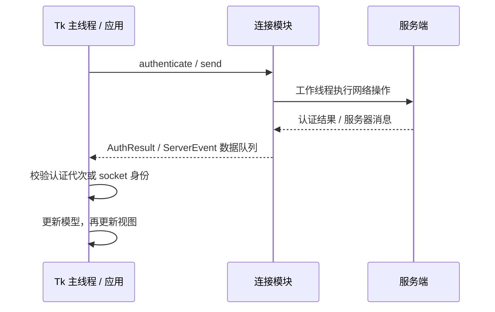

# Python 客户端结构

客户端采用组合：`ChatApplication` 协调状态、连接、历史、增量同步、未读和视图。`client.py` 创建组件并启动 Tk，不包含业务事件分支。登录界面支持保存并切换服务器配置；`client.py` 顶部常量只提供首次启动默认值。启动命令仍为 `python client.py`。

## 模块与依赖

| 模块 | 负责 | 不负责 |
| --- | --- | --- |
| `client.py` | 入口、服务器地址 / 端口 / 指纹、兼容的协议函数导出 | 控件布局、线程循环、业务处理 |
| `models.py` | `ClientState`、`ChatKey`、`Conversation`、`Message` | Tk、socket、加密 |
| `connection.py` | 认证、socket、会话密钥、收发队列及线程生命周期 | 控件及业务消息的解释 |
| `protocol.py` | TCP 长度头、JSON、AES-GCM、服务器公钥校验 | 会话缓存、界面 |
| `app.py` | 用户操作、发送确认、账号草稿、事件泵及退出协调 | Tk 布局和网络读写循环 |
| `events.py` | 消息类型到处理函数的映射，更新状态并通知视图 | 后台线程及控件创建 |
| `history.py` | 请求游标、分页完成与失败重试 | 网络线程、消息气泡 |
| `sync.py` | 固定边界的前向补取、分页校验与完成游标 | 自动重发消息、认证 |
| `reconnect.py` | 退避间隔、取消令牌和尝试次数 | Tk、网络认证 |
| `preferences.py` / `settings_view.py` | 原子配置存储、服务器配置校验和设置窗口 | 密码或消息正文落盘 |
| `activity.py` / `notifications.py` | 已读位置、未读编号、提醒策略和原生提醒工作线程 | Tk 后台访问、正文持久化 |
| `view.py` / `group_view.py` | 输入、Tk 控件、消息渲染和群窗口 | 初始化账号数据、保存历史记录 |

`transport.py` 继续与 Python 服务端共用，负责协议 v2 的 HMAC、方向密钥、序号和完整帧发送锁。帧协议保持不变；服务端通过可选 `message_sync` 能力声明增量补取支持。

视图接收控制器提供的操作，按模型渲染。事件和历史组件通过应用传入的接口调用视图；网络模块不导入视图。模型、连接和应用控制器均可在不加载 Tk 的情况下导入，领域测试不需要图形桌面。

## 状态归属

- `ClientState` 在应用构造时创建全部业务状态。创建或切换界面不会创建另一套好友、群聊或历史数据。
- `ChatKey('private', username)` 与 `ChatKey('group', gid)` 明确区分会话，界面框架也使用相同键。群消息不再通过 `group_messages_<gid>` 动态属性存储。
- 每个 `Conversation` 一起维护消息、排序索引、已见消息 ID、分页游标和耗尽标记。实时消息与历史消息经过同一插入 / 去重路径。
- `Message` 保存原始作者、正文、时间、服务器 ID 和发送者标记；显示前缀和气泡样式由视图决定。
- 当前连接、密钥、认证代次和线程归 `ConnectionManager`；窗口、控件和滚动回调归视图。
- 手动断开或切换账号清除会话状态。异常断线保留会话、消息、选中项、未读和当前输入，完成重新认证后仅替换网络连接。草稿按 `(host, port, username)` 在进程内保存，使用实际连接端点。
- 未读与已读位置按端点和账号存为消息 ID；最近消息预览仅来自内存中的正文。设置不存密码或消息正文。首次历史建立已读基线，历史和补取不逐条发送桌面提醒。
- 持久设置更新在跨进程文件锁内重读、校验并应用当前操作，再原子替换 JSON，避免陈旧实例覆盖其他账号或配置。锁竞争超时保留磁盘和当前实例的原状态；损坏文件仅在明确保存设置时恢复。
- 新服务端为实时消息标记 `history: false`，客户端优先识别该标记，保留登录历史或增量补取期间交错到达消息的未读和提醒。旧服务端及接近帧上限的旧历史仍通过批次状态识别。

## 线程与事件

认证线程只持有连接模块及凭据，不捕获 Tk 回调。成功认证结果由主线程接收、启用连接、创建聊天界面，再启动接收线程。取消认证会增加代次，旧结果不能替换新连接。发送队列和服务器事件都带所属 socket，重连后丢弃旧连接的数据。

主线程每轮最多处理 100 个事件，随后交还 Tk 处理键盘和窗口事件。业务事件使用显式处理表，例如 `private_chat` / `group_chat` 共用消息存储路径，群改名、转让、踢人等各有处理函数。

发送按钮生成 `request_id`，在收到服务器保存确认前保留输入。确认到达时仅清除仍与原发送文本相同的输入；失败或结果未知时不会自动重复发送。

## 历史与退出

`ConnectionManager` 仅在内存保存成功登录的凭据及冻结的端点 / 指纹，用于异常断线后的重新认证。`ReconnectPolicy` 生成 1、2、4、8、15、30 秒的间隔；取消令牌使旧回调失效。手动断开、取消或关闭会忘记凭据。网络失败重试，身份或凭据校验失败停止。重连保留模型和视图，旧连接队列不会发送到新 socket。

`SyncController` 等待新的全局登录历史完成后，以原有账号完成游标和该次历史边界补取所有遗漏消息。每页按 ID 升序发送，保持同一边界；仅匹配请求 ID、起点和边界的完整页可推进。先保存未读元数据，再保存最终同步位置，失败保留旧游标；部分页重试通过消息 ID 去重。旧服务端没有能力标记时保留原游标并提示仅加载最近历史。

历史请求记录发出时的游标，部分到达的消息正常去重，但不据此推进分页。只有匹配会话的 `history_end` 才完成该页；登录快照及其他会话的完成事件不会释放当前请求。退出群或被移除时同时清理对应消息、去重信息和分页状态，重新入群可重新加载。

退出顺序为：保存未读与账号草稿、取消重连与补取、中断连接与认证、停止发送线程、等待网络线程结束、关闭尚未消费的认证 socket、由主线程销毁 Tk。原生提醒工作线程不持有 Tk 对象，静音和退出清除排队的提醒；系统调用有超时。视图在替换界面前取消滚动回调，销毁时取消全部自有定时器，防止延迟回调访问已销毁控件。

## 维护与验证

新增服务器事件时，在 `ServerEvents.handlers` 注册处理函数，更新模型后调用视图接口。修改网络生命周期时，应在连接层验证取消、过期结果和旧连接隔离；控件变化通过真实 Tk 测试验证。避免在连接模块引入控制器 / 视图回调，避免在窗口构造函数里清空业务状态。

测试入口和命令见 [CONTRIBUTING.md](CONTRIBUTING.md)。`test_client_components.py` 不创建 Tk 窗口；`test_regressions.py` 的真实 Tk 测试覆盖选择、输入确认、滚轮、群窗口和退出；`test_history_recovery.py` 检查部分分页失败后的重试；`test_client_drafts.py` 检查账号与端点隔离；`test_go_interop.py` 包含真实客户端到 Go 服务端的登录和发送路径。

v1.1.0 在 Linux / Tk 9 上完整 215 项回归通过，未跳过 Go 测试；包括真实客户端断线后补取 205 条消息、未读去重、免打扰、草稿与会话保留、取消重连及配置落盘隔离。发布流水线继续在 Windows / Linux 上执行完整回归。
