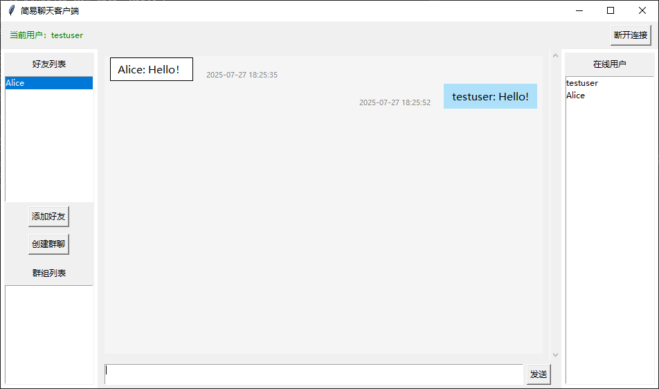

# Encrypted Chat Room

[中文文档](./README.md) | [Go Server Documentation](./go-server/README.md)

## Project Overview

This project is a secure encrypted chat room system implemented in both Python and Go, using RSA session-key exchange, AES-GCM content encryption and HMAC-SHA256 authentication of complete frames. The system supports multiple features including user registration, login, group chat, private chat, friend management, and group management. All messages are persisted in SQLite database, and sensitive information (such as passwords) is securely stored using the Argon2 hashing algorithm.

## Key Features

- 🔒 **Security**
  - Client/server communication using RSA-3072 for key exchange
  - AES-GCM encryption for message bodies and credentials; HMAC-SHA256 authenticates routing and control fields
  - Argon2id password hashing with random salt
  - Secure session key management
  - Server public key fingerprint verification (anti-MITM)
  - Encrypted login (credentials transmitted via AES-GCM)

- 💬 **Social Features**
  - Support for private and group chat
  - Friend request and management
  - Group creation and management
  - Real-time online status updates

- 💾 **Data Management**
  - SQLite database persistence
  - Chat history retrieval
  - User information management
  - Group information maintenance

- 🎨 **User Experience**
  - Saved server profiles with address, port and verified public-key fingerprint
  - Per-conversation unread counts, recent previews, desktop alerts and Do Not Disturb
  - Cancelable automatic reconnection and paginated recovery of missed messages
  - Clean and intuitive graphical interface
  - Real-time message notifications
  - Group member management
  - User-friendly error handling

- 🖼️ **Interface Showcase**
  - Login Interface
    
  - Main Page
    
  - Chat Interface
    

- 🛠 **Technical Stack**
  - Python 3.11+ (Client/Server)
  - Tkinter (GUI interface)
  - pycryptodome (Encryption features)
  - argon2-cffi (Password hashing)
  - Go 1.24+ (Server, toolchain `go1.24.5`)
  - SQLite3 (Data storage)
  - Built-in modules (socket, threading, datetime, logging, etc.)

## Current development protocol

Upgrade the Python client and chosen server together. Protocol v2 rejects unauthenticated frames and plaintext login. A directional HMAC key and uint64 sequence counter protect each transport frame. Starting with v1.2.0, the desktop client also encrypts private and group messages **end to end** with Ed25519 signatures, ephemeral X25519 key agreement, and AES-256-GCM. Servers store and relay opaque envelopes. Routing and membership metadata remain visible; legacy history is explicitly labelled as not end-to-end encrypted.

The client requires a separate local key passphrase, different from the account password. Neither this passphrase nor private keys are uploaded. Compare contact fingerprints through another trusted channel, explicitly approve group recipients, and export an encrypted key backup from the encryption/key window. Restore that backup before logging in on another computer. Lost private keys cannot be recovered from the account password or server database. First-use trust requires independent verification, and this protocol does not provide forward secrecy against later compromise of a recipient's long-term private key. See [encryption, recovery and limitations](END_TO_END_ENCRYPTION.md).

Pending friend requests and group invitations survive server restarts and expire after 24 hours. Existing databases automatically receive the new tables and message indexes. Login loads at most 100 recent authorized messages; the GUI's “加载更早的消息” button retrieves earlier pages for the selected conversation.

The client requires `client.py`, the complete `chatroom_client/` package, `transport.py`, and the dependencies. Download `chatroom-v1.2.0-client.zip` for a runnable client source bundle, or the complete source archive for the entire project. The Python server additionally requires `e2ee_server.py`, `history_store.py`, `pending_store.py`, `storage.py`, and the client package's public cryptographic validators. Transport v2 and storage encryption v1 remain unchanged; an additive schema upgrade records public identities and marks encrypted message envelopes. The v1.2.0 desktop client requires a v1.2.0 server and never silently downgrades. Back up the database and storage key before upgrading; do not run old servers against the upgraded database.

## Desktop settings and recovery

Use the server selector and **连接设置…** on the login screen to save multiple server profiles. Python and Go loopback presets are included. Remote servers require a verified SHA-256 public-key fingerprint; the optional login port field affects only the current connection. Profiles cannot be changed during authentication, an active session or reconnection.

Conversation rows show unread counts and recent message previews. Incoming messages stay unread while the window is inactive or minimized; opening a conversation in the foreground marks it read. The title shows the total count. The initial history snapshot establishes a baseline on the first-ever account login. Later logins restore read markers and unread IDs, isolated by endpoint and account. Desktop alerts contain generic text, without message bodies. **消息提醒** controls alerts; **免打扰** preserves unread counts while muting notifications and sounds. Native desktop notifications are best effort (Windows notification icon, Linux `notify-send`, macOS notifications); unavailable backends fall back to a window bell.

Unexpected disconnects retain the current conversation and draft. Reconnection retries after 1, 2, 4, 8, 15 and then 30 seconds, with a **取消重连** button. Credentials stay in memory only and are cleared on explicit disconnect, cancellation or close. Identity or password failures stop reconnection. Updated Python and Go servers replay missed messages in bounded pages against one fixed boundary, including gaps larger than 100 messages. Only a fully completed replay advances the persisted checkpoint; failed recovery can be retried with **重试补取**. Unconfirmed outgoing messages are retained for manual verification and are never automatically resent.

Settings are stored in `%APPDATA%/Chatroom/client.json` on Windows, `$XDG_CONFIG_HOME/chatroom/client.json` (or `~/.config/chatroom/client.json`) on Linux, and `~/Library/Application Support/Chatroom/client.json` on macOS. `CHATROOM_CONFIG_DIR` overrides the directory. Settings contain profile data, notification preferences, account identifiers and message IDs; no passwords, message bodies or drafts. Drafts last only for the current process. Source constants supply defaults on the first launch; saved profiles take precedence afterward.

## Security Design

- Message bodies and credentials are encrypted with AES-GCM; all post-key-exchange frames are authenticated, with independent keys and counters per direction
- Session key is securely exchanged using RSA public key encryption between client and server
- User passwords are stored using Argon2 hash algorithm
- All user, message, friend, and group info are persisted in SQLite database

## Environment Requirements

### Python Client/Server
- Python 3.11 or higher
- Required modules:
  - socket, threading, datetime, sqlite3, hashlib, logging (built-in)
  - struct, json (built-in)
  - pycryptodome (AES, RSA encryption/decryption, install via `pip install pycryptodome`)
  - argon2-cffi (password hashing, install via `pip install argon2-cffi`)
  - Tkinter (GUI, usually built-in, may require separate installation on some systems)

### Go Server
- Go 1.24.5 or higher
- Required modules (automatically managed by Go modules):
  - github.com/google/uuid (for generating group IDs)
  - golang.org/x/crypto (for Argon2 password hashing)
  - modernc.org/sqlite (for SQLite database support)

## Directory Structure

```
chatroom/
├── client.py                          # Client entry point and server configuration
├── chatroom_client/                   # Composed desktop client
│   ├── app.py                        # Application actions and event pump
│   ├── models.py                     # Session, conversation and message data
│   ├── connection.py                 # Authentication, socket workers and shutdown
│   ├── protocol.py                   # TCP framing, encryption and identity checks
│   ├── e2ee_crypto.py                # End-to-end envelopes, signatures and public keys
│   ├── key_vault.py                  # Encrypted local keys, backups and trust records
│   ├── encryption.py                 # End-to-end messaging and identity coordination
│   ├── encryption_view.py            # Fingerprints, group approval and key recovery
│   ├── runtime_check.py              # Frozen encryption dependency self-check
│   ├── events.py                     # Server event dispatch and handlers
│   ├── history.py                    # Retry-safe history pagination
│   ├── sync.py                       # Complete bounded catch-up and durable cursor
│   ├── reconnect.py                  # Retry delays and cancellation tokens
│   ├── preferences.py                # Private profiles and account metadata
│   ├── settings_view.py              # Server and notification preferences UI
│   ├── activity.py                   # Unread/read markers and notification policy
│   ├── notifications.py              # Native desktop notices and bell fallback
│   ├── view.py                       # Tk widgets and rendering
│   └── group_view.py                 # Group windows
├── CLIENT_ARCHITECTURE.md              # Client architecture and ownership rules
├── server.py                          # Python server code (group chat/session key/group management/database persistence)
├── e2ee_server.py                      # Public identity and encrypted envelope validation
├── requirements.txt                   # Python dependency list
├── go-server/                         # Go language implementation of the server
│   ├── README.md                      # Go server documentation
│   ├── go.mod / go.sum                # Go module definition and checksums
│   ├── start.bat                      # Windows startup script
│   ├── cmd/server/main.go             # Server main program entry point
│   └── internal/
│       ├── crypto/                    # Encryption module
│       ├── database/                  # Database operations (incl. Argon2id hashing)
│       ├── handlers/                  # Request handlers (auth/chat)
│       ├── models/                    # Data models
│       ├── protocol/                  # Communication protocol
│       ├── server/                    # Server core logic
│       └── types/                     # Type definitions
├── images/                            # Interface screenshots
├── transport.py                       # Protocol v2 frame authentication
├── history_store.py                   # Bounded history pagination
├── pending_store.py                   # Durable requests and invitations
├── tests/
│   ├── test_regressions.py            # Python and Tk regression tests
│   ├── test_transport.py              # Frame authentication and replay tests
│   └── test_go_interop.py             # Real Go server interoperability
├── .github/workflows/                 # GitHub Actions workflows
│   └── build-executables.yml          # Cross-platform auto build
├── README.md                          # Chinese documentation
├── README_en.md                       # English README
├── GROUP_FEATURES_GUIDE.md            # Group features guide
└── LICENSE                            # GNU GPL v3 License
```

## Testing

Install `requirements.txt` first. Windows: `python -m unittest discover -s tests -v`.
On headless Linux, install `python3-tk`, `xvfb`, and `xauth`, then run `xvfb-run -a python -m unittest discover -s tests -v`.

Go interoperability tests are skipped unless `CHATROOM_GO_SERVER_EXE` points to a built server binary. Build it from `go-server` with `go build -o ../go-interop-server ./cmd/server` and set the variable to its absolute path (`.exe` on Windows).

From `go-server`, run `go vet ./...`, `go test ./...`, and `go test -race ./...` (the race detector needs a C compiler).

Pull requests, ordinary commits and releases share the Windows/Linux regression workflow before binaries are built.

## Database Information

The database file (`chat.db`) will be automatically created when the Go server is run for the first time.

## Database Structure

The system uses an SQLite database to store user, message, friend, and group information, including the following tables:

1. `users` table: Stores user information
   - id: User ID
   - username: Username (unique)
   - password: Password (Argon2 hash)

2. `messages` table: Stores chat messages
   - id: Message ID
   - chat_type: Chat type (private/group)
   - from_user: Sender
   - to_user: Receiver (used for private chat)
   - gid: Group ID (used for group chat)
   - message: Message content
   - timestamp: Timestamp

3. `friends` table: Stores friend relationships
   - user: User
   - friend: Friend

4. `groups` table: Stores group information
   - gid: Group ID
   - group_name: Group name
   - owner: Group owner
   - members: Group members (JSON format)
   - created_at: Creation time

## Running Instructions

### Python Server

```bash
python server.py
```

The server will automatically generate RSA key pair (private_key.pem and public_key.pem) on first startup.

### Go Server

On Windows systems, you can use the start.bat script to start:

```bash
cd go-server
start.bat
```

Or run the executable directly:

```bash
cd go-server
./chatroom-server.exe
```

**Linux/macOS:** (build first)

```bash
cd go-server
go build -o chatroom-server ./cmd/server/main.go
./chatroom-server
```

Both servers only listen on `127.0.0.1` by default for security.

### Client

```bash
python client.py
```

The client connects to `127.0.0.1:12345` (Python server) by default. Modify the constants at the top of `client.py`:

| Scenario | Change |
|----------|--------|
| Connect to Go server | `SERVER_PORT = 12346` |
| Connect to a remote server | Set `SERVER_HOST` to the target IP or domain |
| Connect to a non-local server (production) | Set `EXPECTED_SERVER_KEY_FINGERPRINT` to the server's public key fingerprint |

> ⚠️ When connecting to a non-local server, you **must** set
> `EXPECTED_SERVER_KEY_FINGERPRINT`, otherwise the client will refuse the connection
> (anti-MITM). Obtain the fingerprint from the server log after your first local connection.

## Notes

- The Python server default port is `12345` (listens on `127.0.0.1`)
- The Go server default port is `12346` (listens on `127.0.0.1`)
- The database file (`chat.db`) will be automatically created on first run
- All messages are AES-GCM encrypted for security
- Session key is exchanged via RSA-3072 public key encryption
- Login credentials are transmitted encrypted (`encrypted_login` protocol)
- User passwords are stored using Argon2id + random salt hash algorithm
- Friend relationships are bidirectional
- Group owners cannot directly leave the group chat and must disband the group or transfer ownership first
- Security limits: max message 1 MB, auth timeout 30s, session timeout 30min, rate limit 5/60s
- Log information is output to the terminal for debugging

## Common Issues

- Port occupied: Check if the port is in use or change the port constant (`server.py` / `main.go`)
- Connection failure: Ensure the server is running and the network is operational, and that client port matches the server (Python `12345`, Go `12346`)
- "Server public key fingerprint not configured" refusal: set `EXPECTED_SERVER_KEY_FINGERPRINT` when connecting to a non-local server
- Database errors: Verify write permissions or check sqlite3 installation
- Group chat issues: Ensure group members are correct, owner cannot leave group directly

## Highlights
- Client/server protection: AES-GCM message bodies, RSA-3072 session keys, HMAC-SHA256 authenticated frames
- Password security: Argon2id + random salt hash for user passwords
- Anti-MITM: server public key fingerprint verification
- Encrypted login: credentials transmitted via AES-GCM
- Security hardening: rate limiting, message length limit, connection timeouts
- Group features: group creation, invitation, join, kick, owner management, persistent group info
- Advanced group features: group disbanding, ownership transfer, group name modification
- All messages use structured JSON protocol
- Robust error handling and logging
- Bilingual support (Chinese/English)
- Dual server implementation (Python/Go)
- GitHub Actions cross-platform automated builds


## Encrypted server storage

Both servers use storage v1: randomized AES-256-GCM encrypts message bodies and timestamps, username mappings, Argon2 password hashes, and group names, owners, members and creation times. HMAC-SHA256 username indexes replace readable identities in message routing, friendships and pending requests.

The independent 32-byte key defaults to `chat.db.key` beside the database. Set `CHATROOM_STORAGE_KEY_FILE` to keep it outside the database directory. Back up the key securely and separately; a lost key cannot be replaced to recover the database. POSIX file permissions default to 0600; protect the key with account permissions on Windows.

Stop the old server before upgrading. Startup transactionally migrates legacy data and removes old free pages/WAL before listening. Failed migrations roll back; interrupted cleanup resumes on restart. Missing, corrupt or mismatched keys stop startup. Do not open migrated databases with older servers. Wire protocol v2 is unchanged; v1.0.10 clients remain compatible.

This encrypts sensitive fields rather than the entire SQLite file: table structure, IDs, group IDs, chat types, relationships between opaque indexes, request expiry times and counts remain visible. The running server can decrypt records. Old backups, logs and deleted underlying storage blocks are outside the migration scope. See [storage format and recovery](STORAGE_ENCRYPTION.md).

See [CONTRIBUTING.md](CONTRIBUTING.md) for development and release instructions.
