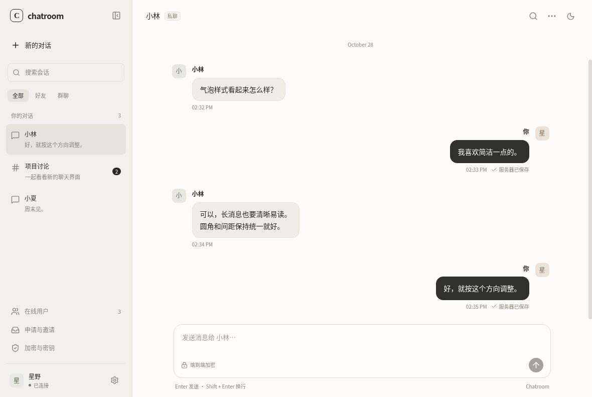
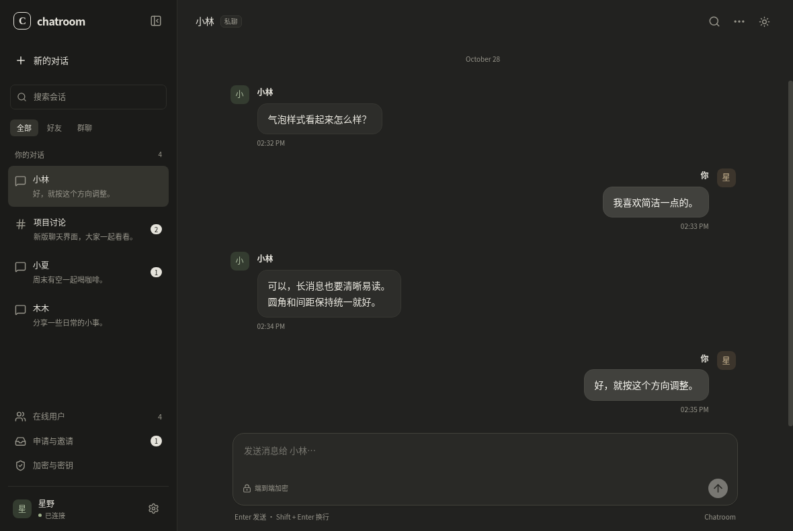
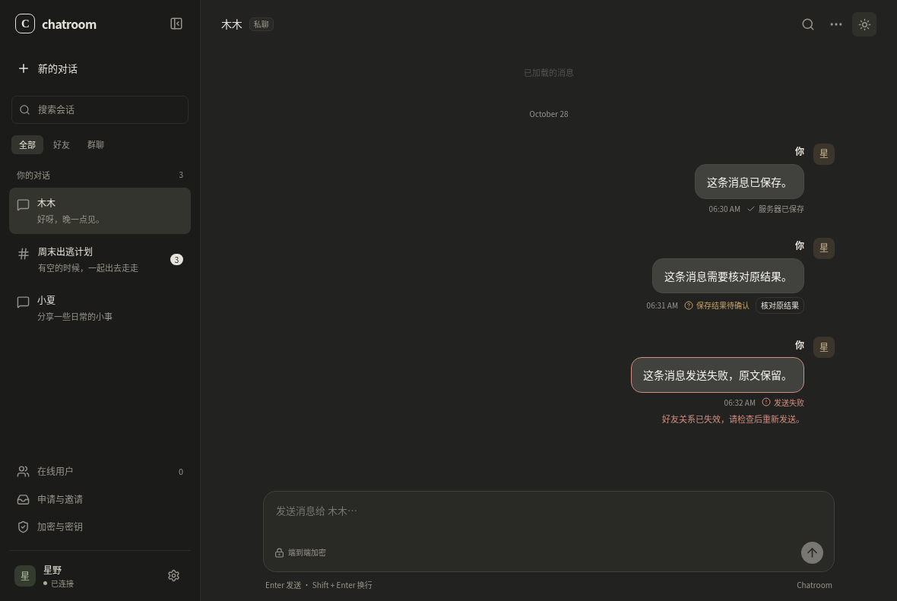
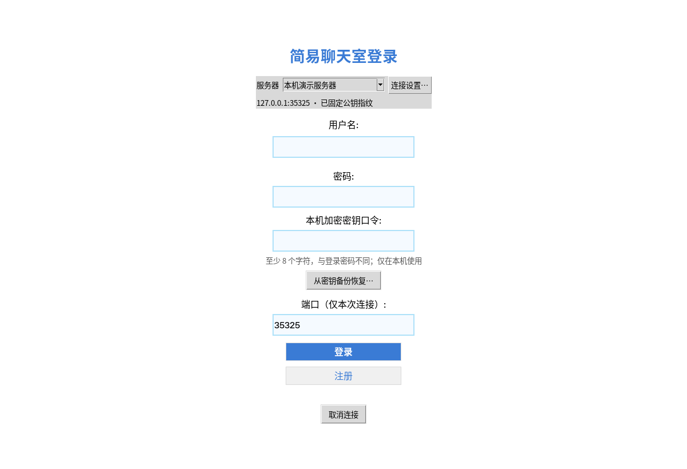
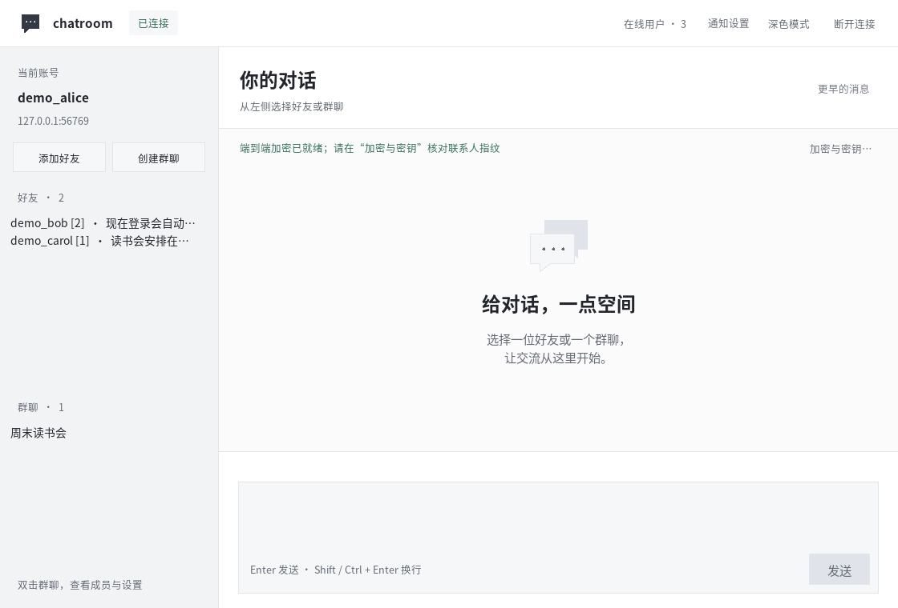
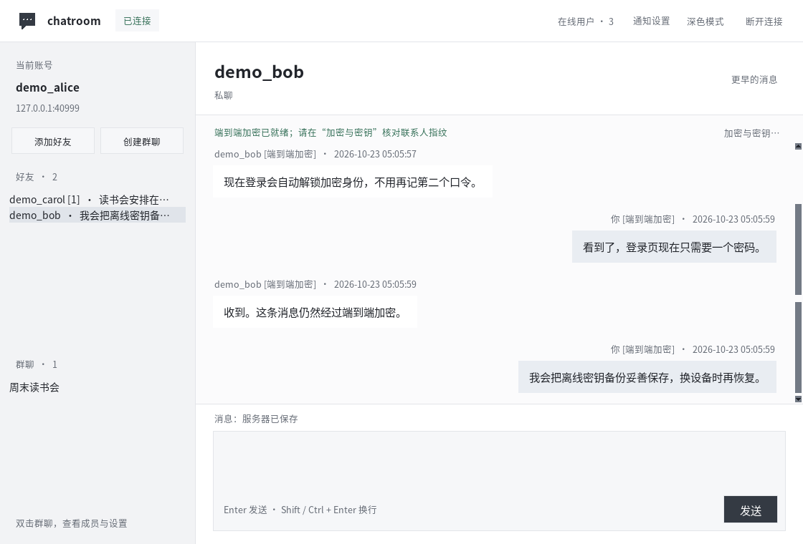
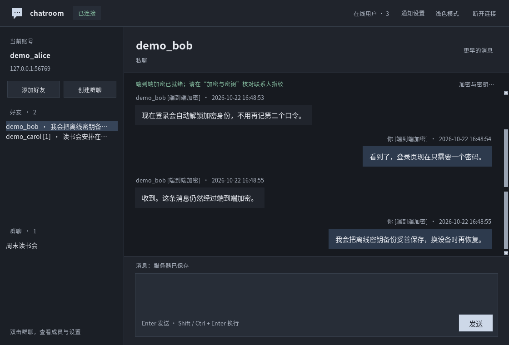

# Encrypted Chat Room

[中文文档](README.md) | [Documentation](docs/README.md) | [Go Server Documentation](go-server/README.md)

> **v2.0.5: server text validation and RSA key compatibility fixes.** The UI uses **Electron + React + TypeScript**, with a separate Python core behind versioned JSON-RPC for future Rust replacement. [Download](https://github.com/starryuchuu/chatroom/releases/tag/v2.0.5) · [Release notes](RELEASE_NOTES.md) · [Desktop guide](docs/DESKTOP_CLIENT.md).

## Project Overview

This project implements an encrypted desktop chat room with Python and Go servers. It supports registration, login, private and group chat, friends, and group management. Release v2.0.2 rebuilds the desktop with a two-column layout, virtualized messages, incoming messages on the left, outgoing messages on the right, and an online-user panel. Send recovery, bounded caches, drafts and local search are retained. Persistent light and dark modes remain available. OPAQUE single-password authentication and unlocking of the encrypted chat identity were introduced in v1.3.0. RSA session-key exchange, AES-GCM and HMAC-SHA256 protect transport frames; clients encrypt chat bodies end to end. Servers persist records in SQLite with encrypted sensitive fields.

## Key Features

- 🔒 **Security**
  - Client/server communication using RSA-3072 for key exchange
  - AES-GCM encryption for message bodies and credentials; HMAC-SHA256 authenticates routing and control fields
  - OPAQUE single-password authentication and encrypted identity recovery
  - Argon2id for OPAQUE password stretching and explicit offline backups
  - Secure session key management
  - Server public key fingerprint verification (anti-MITM)
  - Normal registration and login do not send the account password to the server

- 💬 **Social Features**
  - Support for private and group chat
  - Friend request and management
  - Group creation and management
  - Real-time online status updates

- 💾 **Data Management**
  - SQLite database persistence
  - Chat history retrieval
  - User information management
  - Group information maintenance

- 🎨 **User Experience**
  - Saved server profiles with address, port and verified public-key fingerprint
  - Per-conversation unread counts, recent previews, desktop alerts and Do Not Disturb
  - Cancelable automatic reconnection and paginated recovery of missed messages
  - Immediate light/dark switching on login and chat screens, with the choice saved across restarts
  - Clean and intuitive graphical interface
  - Real-time message notifications
  - Group member management
  - User-friendly error handling

- 🖼️ **New desktop preview**

  

  

  Incoming messages appear on the left and your messages on the right. A single check and “服务器已保存” mean the server saved the message; they do not indicate recipient delivery or reading.

  <details>
  <summary>View uncertain and failed message examples</summary>

  

  Reconcile an uncertain result first; an explicit retry is available only after the server reports no saved receipt. See [message sending status](docs/DESKTOP_CLIENT.md#消息发送状态).

  </details>

  Captured from the [v2.0.4 source](https://github.com/starryuchuu/chatroom/tree/v2.0.4) on 2026-10-28 in real Electron content areas, with synthetic chats and states. System title bars are outside the captures. E2EE and persistence behavior are tested separately against the Python and Go servers and desktop clients. See [capture notes](docs/images/README.md).

- 🖼️ **Historical v1.3.2 Interface Showcase**
  - Login Interface
    
  - Main Page
    
  - Chat Interface
    
  - Dark Mode
    

  Captured from the [v1.3.2 source](https://github.com/starryuchuu/chatroom/tree/v1.3.2) on 2026-10-23, using Linux, Python 3.13.5, Tk 8.6.16 and 1120 × 760 windows. The login screen shows one password field and the **迁移旧账号…** and **解锁旧密钥…** actions. Use the top-right **深色模式** / **浅色模式** button on the login or chat screen to switch themes. The demo uses a temporary local Python server, fresh keys and configuration, and synthetic accounts `demo_alice`, `demo_bob` and `demo_carol`. Fonts and window appearance vary by operating system. See [screenshot notes](docs/images/README.md).

- 🛠 **Technical Stack**
  - Python 3.11+ (Client/Server)
  - Electron + React + TypeScript + Vite (desktop UI; Node.js 24 for development)
  - pycryptodome (Encryption features)
  - argon2-cffi (Offline backup encryption and legacy password verification)
  - wasmtime 50.0.1 (Runs the bundled OPAQUE WebAssembly core)
  - Go 1.27.3 recommended and fixed for CI/releases (server; `go.mod` language minimum 1.26.0)
  - wazero (Runs the same embedded OPAQUE core in the Go server)
  - SQLite3 (Data storage)
  - Built-in modules (socket, threading, datetime, logging, etc.)

## Current protocol

Release v1.5.0 adds send-result reconciliation and idempotent retries, bounded message-body caches, and Ctrl+F search in the existing chat page. See [send recovery, caches and search](docs/SEND_RECOVERY_AND_CACHE.md) for usage, compatibility and reload limits.

v2.0.4 displays sending, saved, uncertain, checking, retry and failure states beside message bubbles. Reconcile the original result or explicitly retry from the bubble; failures show a reason and preserve the input. A single check means server persistence, not recipient delivery or reading. Confirmation replaces the local placeholder without merging distinct messages that have identical text. See the [desktop guide](docs/DESKTOP_CLIENT.md#消息发送状态).

Use the v2.0.4 desktop client with a v1.3.0 or newer Python or Go server. OPAQUE was introduced in v1.3.0; v2.0.4 preserves transport v2, database and key formats; the send_receipts table was added in v1.5.0; existing OPAQUE accounts need no migration. Upgrade both ends for receipt lookup and idempotent retries. Older servers remain compatible, but a timed-out history request requires reconnecting before retrying. The modern client requires both `e2ee_v1` and `opaque_v1`; it refuses older servers instead of sending a password through legacy login. Transport v2 continues to authenticate complete frames with directional HMAC keys and uint64 sequence counters. Private and group chat use Ed25519 signatures, ephemeral X25519 key agreement, and AES-256-GCM. Servers store and relay opaque envelopes. Routing and membership metadata remain visible; legacy history is explicitly labelled as not end-to-end encrypted.

Normal registration and login use one unified password. OPAQUE derives a client-only export key, which unlocks a randomly generated chat identity rather than deriving that identity from the username or password. The cloud backup contains only the encrypted identity; it does not synchronize contact verification, group approvals, or replay state. A new device can recover the same identity after successful authentication, but contacts must be verified again. The two-layer local v2 vault retains its full trust state across password changes, including recovery with the new password after another device changes it. Never overwrite newer local trust with a cloud snapshot.

Use **恢复与迁移 → 迁移旧账号** on the login screen for a one-time upgrade of an existing account. Prepare its old login password, original local key passphrase and a new unified password of 8–128 characters. The local passphrase may be left empty only if the account never enabled end-to-end encryption; the new password must differ from the old login password. Only this explicit migration sends the old login password inside the authenticated encrypted transport for legacy verification. Keep the original vault or import its encrypted offline backup first; a missing or incorrect original identity stops migration. Unmigrated accounts remain usable by legacy clients; migrated and newly registered accounts reject legacy authentication. See the [single-password migration and recovery guide](docs/SINGLE_PASSWORD.md).

If the server committed a migration but its reply was lost, the local vault may still be v1. On the login screen, choose **恢复与迁移 → 解锁旧密钥**, enter the original local passphrase, then log in normally with the new unified password. Successful authentication upgrades the original local vault while preserving its identity and full trust state; do not repeat the account migration.

Use **修改账号密码…** in the encryption/key window to authenticate the current password and set a new one. The identity and chat keys are retained. Explicit offline exports still use Argon2id and AES-GCM with the password at export time; re-export after changing it. A raw v2 vault file cannot be unlocked offline using the password alone. If the password and all usable recovery materials are lost, the server cannot guarantee recovery. Compare contact fingerprints through another trusted channel and explicitly approve group recipients. First-use trust requires independent verification; the chat protocol does not provide forward secrecy against later compromise of a recipient's long-term private key. See [encryption, recovery and limitations](docs/END_TO_END_ENCRYPTION.md).

Saving contact verification compares the fingerprint displayed in the window with the current vault record again; a concurrent key change stops the operation and requires a fresh review. Export backups to a separate file. The client rejects its live vault path and symbolic-link or hard-link aliases of that file.

Pending friend requests and group invitations survive server restarts and expire after 24 hours. Existing databases automatically receive the new tables and message indexes. Login loads at most 100 recent authorized messages; the history action retrieves earlier pages for the selected conversation (use “更多 → 加载更早消息”).

Both servers enforce a maximum of **256 actual group members, including the owner**, when creating groups, inviting users and accepting invitations. Invitations do not reserve capacity; an unexpired invitation can be retried after space becomes available. Group creation bounds and validates the raw member list before deduplication and batch lookup. Existing oversized groups keep their members and can shrink through leave/kick operations.

Download the Windows / Linux x64 desktop ZIP from the [v2.0.5 release page](https://github.com/starryuchuu/chatroom/releases/tag/v2.0.5), extract the complete archive, and run `chatroom.exe` / `./chatroom`. Packaged applications bundle Electron and the Python core; users need no Python or Node.js installation. macOS desktop releases are not yet provided. For development or Python servers, use the single complete [chatroom-v2.0.5-source.zip](https://github.com/starryuchuu/chatroom/releases/download/v2.0.5/chatroom-v2.0.5-source.zip), which includes the desktop, shared Python modules and precompiled OPAQUE WASM. Install Python dependencies, then run `npm ci && npm start` from `desktop/` (Node.js 24 required). Rebuilding the authentication core requires Rust 1.87+; the desktop core itself remains Python in this release.

`requirements.txt` pins Python runtime dependencies and their transitive packages. Developers building executables use `requirements-build.txt`, which also pins packaging dependencies; it is not needed for source development.

The shared core uses `opaque-ke` 4.0.1 and RFC 9807 OPAQUE, executed by Python Wasmtime and Go wazero. The upstream library has an audit history; that does not establish an independent audit of this exact version, its WASM build, or Chatroom's integration. v1.3.0 adds persistent OPAQUE setup and account tables while retaining transport v2 and storage encryption v1. Back up the database, storage key, server RSA key pair and client offline key backup before upgrading. Preserve the OPAQUE setup together with its account records, and do not run old servers against the upgraded database.

## Desktop settings and recovery

The client offers light and dark themes with a two-column layout. Click **深色模式** or **浅色模式** at the top right of the login or chat screen to switch immediately. Drafts, entered text, the active chat connection and already-open application dialogs are preserved. The default is light mode; the client does not automatically follow the system theme. Native file pickers and message boxes remain controlled by the operating system. Click **在线用户** at the bottom of the sidebar to view and search online users; the count includes yourself. After disconnecting, the panel labels the retained list as stale. Enter sends a message; Shift+Enter or Ctrl+Enter inserts a newline.

Click **创建新账号** to switch the existing card to signup and **已有账号？返回登录** to return. Successful signup keeps the username and clears the password; errors appear in the form. Enter activates the focused button, while Enter in an input submits the current form. The centered login card scrolls when large text or the available height requires it, and keyboard focus automatically brings each control into view. Long sidebar previews use an ellipsis while the full message remains available in the conversation.

Incoming messages preserve the friend/group lists' scroll, selection and keyboard navigation positions. While you read earlier chat history, arrivals retain the visible message instead of jumping to the bottom. Click **N 条新消息 ↓** to reach the latest messages; scrolling there manually also clears the indicator. A view already at the bottom and your own live sends continue to follow new messages. Reconnection redraws preserve the reading position, and small mouse-wheel deltas scroll correctly.

Use the server selector and **设置 → 服务器** on the login screen to save multiple server profiles. Python and Go loopback presets are included. Remote servers require a verified SHA-256 public-key fingerprint; the optional login port field affects only the current connection. Profiles cannot be changed during authentication, an active session or reconnection.

Conversation rows show unread counts and recent message previews. Incoming messages stay unread while the window is inactive or minimized; opening a conversation in the foreground marks it read. The title shows the total count. The initial history snapshot establishes a baseline on the first-ever account login. Later logins restore read markers and unread IDs, isolated by endpoint and account. **设置 → 通用** contains desktop-notification and Do Not Disturb controls. v2.0.3 adds three notification detail levels: generic, sender/conversation (default), and message preview. Message previews may appear in the OS notification history or on the lock screen. The Windows portable app registers a per-user Start Menu shortcut and AppUserModelID; clicking a notification opens its conversation and preserves the current draft. Notifications use Electron system integration and depend on OS permissions and settings; Do Not Disturb preserves unread counts.

Unexpected disconnects retain the current conversation and draft. Reconnection retries after 1, 2, 4, 8, 15 and then 30 seconds, with a **取消重连** button. Credentials stay in memory only and are cleared on explicit disconnect, cancellation or close. Identity or password failures stop reconnection. Updated Python and Go servers replay missed messages in bounded pages against one fixed boundary, including gaps larger than 100 messages. Only a fully completed replay advances the persisted checkpoint; failed recovery can be retried with **重试补取**. Unconfirmed outgoing messages are retained for manual verification and are never automatically resent.

Settings are stored in `%APPDATA%/Chatroom/client.json` on Windows, `$XDG_CONFIG_HOME/chatroom/client.json` (or `~/.config/chatroom/client.json`) on Linux, and `~/Library/Application Support/Chatroom/client.json` on macOS. `CHATROOM_CONFIG_DIR` overrides the directory. Settings contain the theme, profile data, notification preferences, account identifiers and message IDs; no passwords, message bodies or drafts. The top-level `theme` value is `light` or `dark`, defaults to `light` when absent, and is saved across restarts without changing schema version 1. Drafts last only for the current process and are isolated by server, account and conversation. Source constants supply defaults on the first launch; saved profiles take precedence afterward.

## Security Design

- Chat bodies use end-to-end AES-GCM; all post-key-exchange frames are authenticated, with independent keys and counters per direction
- Session key is securely exchanged using RSA public key encryption between client and server
- Modern accounts store OPAQUE registration records and encrypted identity-only backups; legacy Argon2 password verification remains only for unmigrated accounts and explicit migration
- All user, message, friend, and group info are persisted in SQLite database

## Environment Requirements

### Python Client/Server
- Python 3.11 or higher
- Required modules:
  - socket, threading, datetime, sqlite3, hashlib, logging (built-in)
  - struct, json (built-in)
  - pycryptodome (AES and RSA encryption/decryption; pinned in `requirements.txt`)
  - argon2-cffi (offline backups and legacy password verification)
  - wasmtime==50.0.1 (bundled OPAQUE WASM runtime)
  - Node.js 24 and npm for desktop development; packaged applications bundle their runtimes

### Go Server
- Go 1.27.3 recommended, matching CI and release builds (`go.mod` language minimum: 1.26.0)
- Required modules (automatically managed by Go modules):
  - github.com/google/uuid (for generating group IDs)
  - golang.org/x/crypto (for Argon2 password hashing)
  - modernc.org/sqlite (for SQLite database support)
  - github.com/tetratelabs/wazero (shared OPAQUE WASM runtime, embedded in the executable)

## Directory Structure

```
chatroom/
├── client.py                 # Electron launcher using the selected Python
├── core_client.py            # Headless Python / JSON-RPC entry point
├── desktop/
│   ├── electron/             # Main process, restricted preload and core bridge
│   ├── src/                  # React UI, themes and protocol types
│   ├── scripts/              # Development, build and license collection
│   └── tests/                # Real Electron and two-client E2EE checks
├── chatroom_client/          # Model, crypto, connection, sync and RPC adapter
│   └── view.py and others    # Legacy Tk views, retained for regression tests
├── server.py                 # Python server entry point
├── server_handlers/          # Friend, group and message handlers
├── go-server/                # Go server and build files
├── opaque-core/              # Locked Rust source for OPAQUE WASM
├── scripts/                  # Core rebuild, CI planning and release helpers
├── tests/                    # Python, legacy Tk, core and Go interoperability
├── docs/                     # Guides, architecture, screenshots and validation
├── .github/                  # Daily CI, tagged releases and dependency updates
├── requirements.txt          # Pinned Python runtime dependencies
├── requirements-build.txt    # Pinned Python build dependencies
├── VERSION                   # Canonical version
├── CONTRIBUTING.md           # Development, checks and release conventions
├── RELEASE_NOTES.md          # Reviewed per-version release notes
└── LICENSE                   # GNU GPL v3 license
```

## Daily CI and releases

Ordinary pushes and PRs select Linux checks by changed component; they do not package every platform. Matching pushes already covered by an open PR avoid duplicate runs. Source privacy checks remain enabled.

From a clean `master`, run `python scripts/release.py 1.6.0` to synchronize every version copy, commit, create an annotated tag and atomically push the branch and tag. Add `--dry-run` to plan locally without changes or network access. The tag workflow validates master ancestry and matching versions, runs the full Windows/Linux tests, builds the platform artifacts and publishes the exact tagged commit. The workflow extracts the requested version from `RELEASE_NOTES.md`; add and commit that section before running the release command.

Attachments contain the desktop/server binaries, one complete source ZIP, required notices and `SHA256SUMS`. See the [contribution guide](CONTRIBUTING.md#日常推送与发布) for retries and checks.

## Testing

Install `requirements.txt` first. Windows: `python -m unittest discover -s tests -v`.
On headless Linux, install `python3-tk`, `xvfb`, and `xauth`, then run `xvfb-run -a python -m unittest discover -s tests -v`.

Go interoperability tests are skipped unless `CHATROOM_GO_SERVER_EXE` points to a built server binary. Build it from `go-server` with `go build -o ../go-interop-server ./cmd/server` and set the variable to its absolute path (`.exe` on Windows).

From `go-server`, run `go vet ./...`, `go test ./...`, and `go test -race ./...` (the race detector needs a C compiler).

Pull requests, ordinary commits and releases share Windows/Linux regression and build workflows. Tests and builds run in parallel; publication requires both to succeed.

Builds use Go 1.27.3. Windows / Linux CI checks Python runtime and build requirements with `pip-audit`; Linux CI checks the Go server with `govulncheck`; pinned tool versions and local commands are in [CONTRIBUTING.md](CONTRIBUTING.md). Dependabot update configuration covers Python, Go, Cargo and GitHub Actions. Repository administrators must separately enable security alerts and automatic security updates in GitHub settings; the update configuration does not establish that these switches are enabled. Advisory checks are not an independent security audit of this integration.

## Database Information

The database file (`chat.db`) will be automatically created when the Go server is run for the first time.

## Database Structure

The system uses an SQLite database to store user, message, friend, and group information, including the following tables:

1. `users` table: Stores user information
   - id: User ID
   - username: Username (unique)
   - password: Encrypted legacy Argon2 hash, or the encrypted OPAQUE account marker

2. `messages` table: Stores chat messages
   - id: Message ID
   - chat_type: Chat type (private/group)
   - from_user: Sender
   - to_user: Receiver (used for private chat)
   - gid: Group ID (used for group chat)
   - message: Message content
   - timestamp: Timestamp

3. `friends` table: Stores friend relationships
   - user: User
   - friend: Friend

4. `groups` table: Stores group information
   - gid: Group ID
   - group_name: Group name
   - owner: Group owner
   - members: Group members (JSON format)
   - created_at: Creation time

5. `opaque_meta` and `opaque_accounts`: Persist encrypted OPAQUE setup, registration records, identity-only backups and account generations. Keep the setup and account records together when backing up or restoring.

## Running Instructions

### Python Server

```bash
python server.py
```

The server will automatically generate RSA key pair (private_key.pem and public_key.pem) on first startup.

### Go Server

On Windows systems, you can use the start.bat script to start:

```bash
cd go-server
start.bat
```

Or run the executable directly:

```bash
cd go-server
./chatroom-server.exe
```

**Linux/macOS:** (build first)

```bash
cd go-server
go build -o chatroom-server ./cmd/server/main.go
./chatroom-server
```

Both servers only listen on `127.0.0.1` by default for security.

### Client

```bash
cd desktop
npm ci
npm start
```

Set `CHATROOM_PYTHON` to your Python interpreter when using a virtual environment. Alternatively, run `python client.py` from the repository root to forward the current interpreter. See the [desktop guide](docs/DESKTOP_CLIENT.md) for packaging.

The client defaults to the local Python server at `127.0.0.1:12345`. Select the Go profile or use **设置 → 服务器** on the login screen to save another endpoint and its verified public-key fingerprint. For remote servers, obtain the SHA-256 fingerprint through a trusted channel and save it in that profile. Source constants only supply first-launch defaults; existing saved profiles take precedence.

## Notes

- The Python server default port is `12345` (listens on `127.0.0.1`)
- The Go server default port is `12346` (listens on `127.0.0.1`)
- The database file (`chat.db`) will be automatically created on first run
- All messages are AES-GCM encrypted for security
- Session key is exchanged via RSA-3072 public key encryption
- Normal v1.3.0 authentication uses OPAQUE; `encrypted_login` is limited to unmigrated legacy accounts
- OPAQUE registration records replace legacy password hashes after account migration
- Friend relationships are bidirectional
- Group owners cannot directly leave the group chat and must disband the group or transfer ownership first
- Security limits: max message 1 MB, auth timeout 30s, session timeout 30min, rate limit 5/60s
- Log information is output to the terminal for debugging

## Common Issues

- Port occupied: Check if the port is in use or change the port constant (`server.py` / `main.go`)
- Connection failure: Ensure the server is running and the network is operational, and that client port matches the server (Python `12345`, Go `12346`)
- "Server public key fingerprint not configured" refusal: save the independently verified fingerprint in the selected profile through **设置 → 服务器**
- Database errors: Verify write permissions or check sqlite3 installation
- Group chat issues: Ensure group members are correct, owner cannot leave group directly

## Highlights
- Client/server protection: AES-GCM message bodies, RSA-3072 session keys, HMAC-SHA256 authenticated frames
- Password security: OPAQUE authentication, client-only export keys, and Argon2id-protected offline backups
- Anti-MITM: server public key fingerprint verification
- Single-password login: normal account passwords are not sent to the server
- Security hardening: rate limiting, message length limit, connection timeouts
- Group features: group creation, invitation, join, kick, owner management, persistent group info
- Advanced group features: group disbanding, ownership transfer, group name modification
- All messages use structured JSON protocol
- Robust error handling and logging
- Bilingual support (Chinese/English)
- Dual server implementation (Python/Go)
- GitHub Actions cross-platform automated builds


## Encrypted server storage

Both servers use storage v1: randomized AES-256-GCM encrypts message bodies and timestamps, username mappings, legacy password hashes, OPAQUE setup/account records and identity backups, and group names, owners, members and creation times. HMAC-SHA256 username indexes replace readable identities in message routing, friendships and pending requests.

The independent 32-byte key defaults to `chat.db.key` beside the database. Set `CHATROOM_STORAGE_KEY_FILE` to keep it outside the database directory. Back up the key securely and separately; a lost key cannot be replaced to recover the database. POSIX file permissions default to 0600; protect the key with account permissions on Windows.

Stop the old server before upgrading. Startup transactionally migrates legacy storage and removes old free pages/WAL before listening. Failed migrations roll back; interrupted cleanup resumes on restart. Missing, corrupt or mismatched keys stop startup. Existing OPAQUE accounts without their setup also stop startup. Do not open upgraded databases with older servers. Transport v2 remains, but v1.3.0 clients require the new OPAQUE capability; legacy clients can authenticate only accounts that have not migrated.

This encrypts sensitive fields rather than the entire SQLite file: table structure, IDs, group IDs, chat types, relationships between opaque indexes, request expiry times and counts remain visible. The running server can decrypt records. Old backups, logs and deleted underlying storage blocks are outside the migration scope. See [storage format and recovery](docs/STORAGE_ENCRYPTION.md).

See [CONTRIBUTING.md](CONTRIBUTING.md) for development and release instructions.
