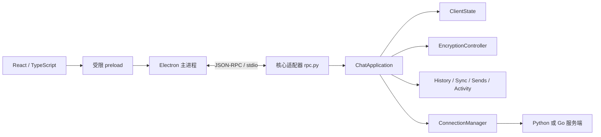
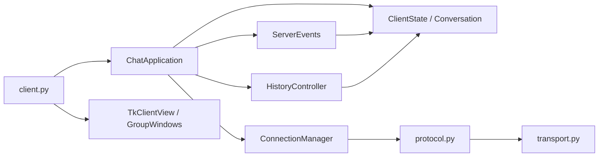
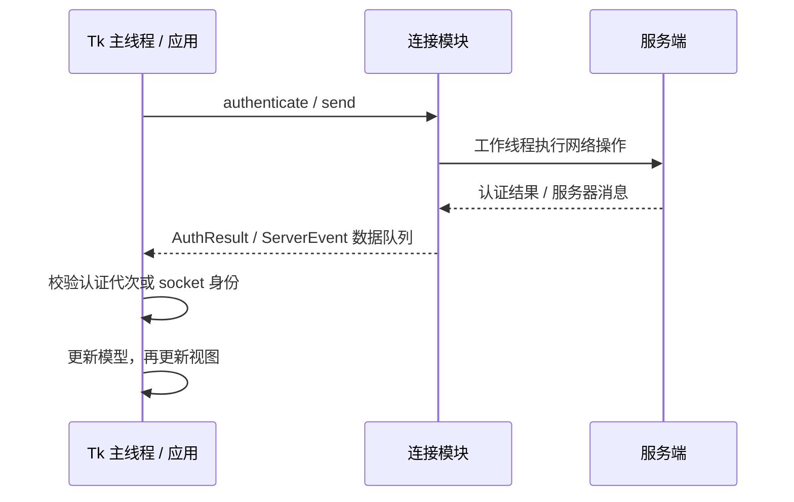

# 客户端结构

## Electron 开发分支

新桌面采用 Electron + React + TypeScript + Vite；Python 作为独立核心，通过带版本号的 JSON-RPC / stdio 与界面通信。未来 Rust 核心实现相同协议即可复用界面，服务器协议及加密格式不变。运行与构建见 [Electron 桌面客户端](DESKTOP_CLIENT.md)，接口见 [Desktop Protocol v1](DESKTOP_PROTOCOL.md)。

`desktop/src/protocol.ts` 定义版本、方法白名单和投影类型；`desktop/electron/core.ts` 仅管理核心进程及传输，不依赖 Python 业务实现。`core_client.py` 与 `chatroom_client/rpc.py` 不导入 Tk：stdin 线程只入队，所有调度、状态及确认均在核心主线程执行。发布的核心显式排除 tkinter。

React Virtuoso 复用可见消息，沿用模型的每会话 2,000 条 / 8 MiB、全账号 8,000 条 / 32 MiB 正文缓存预算。消息编号以字符串穿过 RPC。历史前插使用稳定 ID 和索引偏移，阅读历史时不自动跟随。草稿切换显式提交旧输入；回执清空携带原文本，不能覆盖新编辑。每条变更携带账号会话令牌；发送 / 草稿 / 历史还验证当前聊天键。

群核验使用带 ID 的 `prompt` / `prompt.reply`，等待期间不重入网络事件，超时或断开即拒绝；后续仍执行原有加密上下文检查。私钥始终留在核心。Electron 处理原生文件选择和通知，渲染界面无 Node / 文件系统权限，不将正文、草稿或密码写入应用存储。v2.0.3 可选择向系统通知提供正文摘要，通知历史由操作系统管理，见[桌面通知说明](DESKTOP_CLIENT.md#桌面通知)。

`client.py` 的默认启动入口已改为 Electron。旧 Tk 视图和历史测试暂留源码作为迁移回归基准，不进入新桌面包。下面记录的是 **v1.5.0 已发布 Tk 客户端的历史实现**，新界面入口以以上两份文档为准。

## v1.5.0 Python / Tk 历史结构

客户端采用组合：`ChatApplication` 协调状态、连接、历史、增量同步、未读和视图。`client.py` 创建组件并启动 Tk，不包含业务事件分支。登录界面支持保存并切换服务器配置；`client.py` 顶部常量只提供首次启动默认值。启动命令仍为 `python client.py`。

登录与创建账号共用主窗口中的表单，点击“创建账号”或“已有账号？返回登录”原地切换，保留用户名、密码与服务器配置。注册期间禁用重复提交和模式切换；错误在原表单显示，成功后返回登录模式、保留用户名并清空密码。取消认证后忽略晚到的成功结果。按钮获得焦点时，回车只激活当前按钮；输入框中的回车继续提交当前登录或注册表单。

## 模块与依赖

| 模块 | 负责 | 不负责 |
| --- | --- | --- |
| `client.py` | 入口、服务器地址 / 端口 / 指纹、兼容的协议函数导出 | 控件布局、线程循环、业务处理 |
| `models.py` | `ClientState`、`ChatKey`、`Conversation`、`Message` | Tk、socket、加密 |
| `connection.py` | 认证、socket、会话密钥、收发队列及线程生命周期 | 控件及业务消息的解释 |
| `protocol.py` | TCP 长度头、JSON、AES-GCM、服务器公钥校验 | 会话缓存、界面 |
| `app.py` | 用户操作、发送确认、会话草稿、事件泵及退出协调 | Tk 布局和网络读写循环 |
| `events.py` | 消息类型到处理函数的映射，更新状态并通知视图 | 后台线程及控件创建 |
| `history.py` | 请求游标、分页完成与失败重试 | 网络线程、消息气泡 |
| `sending.py` | 内存待确认记录、回执查询、幂等重试与过期响应过滤 | 持久明文发件箱、自动重发未知结果 |
| `message_actions.py` | 按需原生文本选择、只读键盘操作、共享复制菜单与引用清理 | 修改正文、自动读取或写入剪贴板 |
| `desktop_check.py` | 合成桌面缩放、原生 Unicode 输入、字体与成品检查 | 连接真实账号、证明人工输入法体验 |
| `send_recovery_view.py` | 原页面待确认列表、逐条操作与移除确认 | 发送结果推断、消息正文落盘 |
| `search.py` | 当前缓存正文的字面搜索、结果导航及高亮 | 服务端明文搜索、查询或正文落盘 |
| `request_context.py` | 请求令牌以及连接、账号和群成员代次的统一校验 | 网络操作、Tk 调度 |
| `login_view.py` / `message_list.py` | 登录卡片布局、消息窗口和控件复用 | 账号状态初始化、消息正文落盘 |
| `message_rows.py` | 按需日期 / 作者控件、正文排版、本地时间与消息信息展开 | 修改消息、信任或网络状态 |
| `sync.py` | 固定边界的前向补取、分页校验与完成游标 | 自动重发消息、认证 |
| `reconnect.py` | 退避间隔、取消令牌和尝试次数 | Tk、网络认证 |
| `preferences.py` / `settings_view.py` | 原子配置存储、全局主题选择、服务器配置校验和设置窗口 | 密码或消息正文落盘 |
| `theme.py` | 深浅色调色板、字体、原位换色与应用对话框样式 | 网络状态、系统主题自动跟随 |
| `e2ee_crypto.py` | 签名、消息加密、密钥封装及严格公钥校验 | 网络与身份信任决策 |
| `key_vault.py` | OPAQUE v2 分层身份与本机信任、旧 v1 迁移、完整离线备份 | 上传明文私钥、云端同步信任、保存消息正文 |
| 根 `opaque_runtime.py` / `opaque_core.wasm` | 固定版本 OPAQUE 核心的沙箱调用 | Tk、服务器账号状态、信任决策 |
| `encryption.py` / `encryption_view.py` | 端到端身份登记、相关密钥查询、信任确认、密钥备份界面 | 服务端正文解密、静默降级 |
| `activity.py` / `notifications.py` | 已读位置、未读编号、提醒策略和原生提醒工作线程 | Tk 后台访问、正文持久化 |
| `view.py` / `group_view.py` | 输入、Tk 控件、消息渲染和群窗口 | 初始化账号数据、保存历史记录 |

`transport.py` 继续与 Python 服务端共用，负责协议 v2 的 HMAC、方向密钥、序号和完整帧发送锁。帧协议保持不变；服务端通过 `opaque_v1` 声明单密码认证、`e2ee_v1` 声明端到端支持，正常客户端要求两者。`message_sync` 声明增量补取支持。

`SessionContext` 捕获 socket、账号、会话及群成员代次，历史、加密收发共用失效判断；`RequestToken` 为历史和同步生成独立请求标识。分页等待 20 秒后保留原游标：支持 `history_request_id` 的服务端可安全重试，旧服务端超时后要求重新连接，避免无法区分的晚到结束事件误完成新页。登录及入群快照不携带请求 ID，不能完成现代服务端上的手动分页；接近帧上限的历史可省略逐条关联字段，仍受批次上下文保护。

`MessageList` 每个会话最多创建 120 个显示行，`Conversation` 的正文缓存另有 2,000 条 / 8 MiB 上限，全账号共用 8,000 条 / 32 MiB 预算；已读、未读和分页元数据独立于正文淘汰。滚动到当前窗口边缘时切换有重叠的显示窗口，通过消息身份和像素偏移保留阅读锚点。阅读旧历史时允许淘汰较新正文，再通过“返回最新消息”重新分页取回；被全局预算淘汰的非当前会话在选中后重新加载。未改变的行直接复用，验证失败提示恢复只替换对应行。v1.4.0 的旧测量见[重构与性能记录](reviews/REFACTOR_VALIDATION.md)，当前预算与搜索约定见[发送恢复、缓存和搜索](SEND_RECOVERY_AND_CACHE.md)。

视图接收控制器提供的操作，按模型渲染。事件和历史组件通过应用传入的接口调用视图；网络模块不导入视图。模型、连接和应用控制器均可在不加载 Tk 的情况下导入，领域测试不需要图形桌面。

## 状态归属

- `ClientState` 在应用构造时创建全部业务状态。创建或切换界面不会创建另一套好友、群聊或历史数据。
- `ChatKey('private', username)` 与 `ChatKey('group', gid)` 明确区分会话，界面框架也使用相同键。群消息不再通过 `group_messages_<gid>` 动态属性存储。
- 每个 `Conversation` 一起维护消息、排序索引、已见消息 ID、分页游标和耗尽标记。实时消息与历史消息经过同一插入 / 去重路径。
- `Message` 保存原始作者、正文、时间、服务器 ID 和发送者标记；显示前缀和气泡样式由视图决定。
- 当前连接、密钥、认证代次和线程归 `ConnectionManager`；窗口、控件和滚动回调归视图。
- 侧栏行按会话标识更新并保存选择、ACTIVE、ANCHOR 与顶部可见项，消息摘要刷新和好友/群快照变动不能重置用户正在浏览的位置。聊天视图用可见消息的服务器编号与像素偏移保存阅读锚点（无编号消息使用对象身份），避免消息插入、验证失败提示被成功恢复或重连重绘后跳到其他内容。恢复同一编号的消息不增加新消息提示。
- 手动断开或切换账号清除会话状态。异常断线保留会话、消息、选中项、未读和当前输入，完成重新认证后仅替换网络连接。草稿按 `(host, port, username, ChatKey | None)` 在进程内保存，使用实际连接端点；无选中会话的输入另存。切换时重置撤销栈，迟到确认只条件清空原会话草稿，离群清除对应草稿。
- 未读与已读位置按端点和账号存为消息 ID；最近消息预览仅来自内存中的正文。设置只保存服务器配置、主题、提醒偏好、账号标识与消息编号，不存密码、消息正文或草稿。首次历史建立已读基线，历史和补取不逐条发送桌面提醒。
- 持久设置更新在跨进程文件锁内重读、校验并应用当前操作，再原子替换 JSON，避免陈旧实例覆盖其他账号或配置。锁竞争超时保留磁盘和当前实例的原状态；损坏文件仅在明确保存设置时恢复。
- 新服务端为实时消息标记 `history: false`，客户端优先识别该标记，保留登录历史或增量补取期间交错到达消息的未读和提醒。旧服务端及接近帧上限的旧历史仍通过批次状态识别。

## 深浅色主题

v1.3.1 在登录页和聊天页右上角提供“深色模式” / “浅色模式”按钮，标签表示下一次点击要启用的模式。`PreferencesStore.theme` 读取 `client.json` 的顶层 `theme`，仅允许 `light` / `dark`，旧文件缺失时默认 `light`，配置版本仍为 1。`set_theme(mode)` 使用已有锁内重读与原子替换流程，保留并发更新的账号、通知和服务器配置；显式保存失败抛出 `PreferencesError`。

视图先成功保存选择，再调用 `DesktopTheme.set_mode()`，保存失败时提示并保留当前主题。主题对象原位更新共享颜色字典、ttk 样式以及已有控件、文本标签、列表和应用对话框；不销毁并重建界面，所以输入、草稿、聊天连接、选中会话和已打开窗口保持不变。主题切换在 Tk 主线程执行，不重置业务模型或认证。

主题由用户手动选择，不自动跟随操作系统。系统原生文件选择器和消息框外观由操作系统管理，不属于应用控件换色范围。界面示例与采集环境见[截图说明](images/README.md)。

v1.3.2 收到当前会话消息时，原在底部或本人实时发送才跟随；阅读历史则在一次空闲回调中恢复原消息锚点，批量到达的消息共用同一锚点。`N 条新消息 ↓` 是视图内存状态，点击或手动到底后清除，不写入偏好设置，也不代替业务未读计数。小幅 `<MouseWheel>` 增量保留正确方向，标准 Windows 增量和 X11 Button-4/5 继续使用局部控件绑定。

## 线程与事件

认证线程只持有连接模块及凭据，不捕获 Tk 回调。成功认证结果由主线程接收、启用连接、创建聊天界面，再启动接收线程。取消认证会增加代次，旧结果不能替换新连接。发送队列和服务器事件都带所属 socket，重连后丢弃旧连接的数据。

v1.3.0 正常界面只读取统一密码，旧账号迁移才明确读取旧登录密码与旧本机口令。密钥库准备任务不持有 Tk，由认证工作线程完成 OPAQUE、验证登录结果与已登记公钥后，用客户端导出密钥解锁身份；注册和迁移在服务端提交后才提交本机暂存文件。缺少原私钥时停止，不生成替代身份。公钥登记确认后才允许发出端到端消息；接收人查询绑定 socket、账号、会话和输入，确认期间上下文变化会停止发送。公开签名、会话绑定、GCM 校验与本机最新信任记录全部通过后才显示正文；最终信任与重放检查在同一文件锁内原子完成。

联系人核验同样绑定用户所见指纹：界面传递当前显示的指纹，密钥库在文件锁内与最新记录比较后才标记。并发换钥拒绝陈旧确认。离线导出在写入前拒绝本机库自身路径及其符号链接、硬链接别名，避免备份覆盖运行中的 v2 文件。

主线程每轮最多处理 100 个事件，随后交还 Tk 处理键盘和窗口事件。业务事件使用显式处理表，例如 `private_chat` / `group_chat` 共用消息存储路径，群改名、转让、踢人等各有处理函数。

发送按钮生成 `request_id`，在收到服务器保存确认前保留输入。支持 `message_receipts` 时额外保留稳定的 `idempotency_key`，超时释放发送入口、查询原结果，用户确认重试时只更换 `request_id`。迟到的旧成功或失败不能结束新请求。结果核对与自动重连不自动重发正文，手动断开或群生命周期结束清理对应内存记录。确认只清除当前会话仍与原文本相同的输入；查询恢复显示不会打断阅读位置。

## 历史与退出

`ConnectionManager` 仅在内存保存成功登录的凭据及冻结的端点 / 指纹，用于异常断线后的重新认证。`ReconnectPolicy` 生成 1、2、4、8、15、30 秒的间隔；取消令牌使旧回调失效。手动断开、取消或关闭会忘记凭据。网络失败重试，身份或凭据校验失败停止。重连保留模型和视图，旧连接队列不会发送到新 socket。

`SyncController` 等待新的全局登录历史完成后，以原有账号完成游标和该次历史边界补取所有遗漏消息。每页按 ID 升序发送，保持同一边界；仅匹配请求 ID、起点和边界的完整页可推进。先保存未读元数据，再保存最终同步位置，失败保留旧游标；部分页重试通过消息 ID 去重。旧服务端没有能力标记时保留原游标并提示仅加载最近历史。

同步刷新以 `preserve_scroll=True` 重绘当前会话；更早消息插入后仍恢复同一可见消息的偏移。补取中遇到本人的历史消息也不会当作刚刚发出的消息而跳底；只有实时本人发送或此前已经跟随底部时继续跟随。

历史请求记录发出时的游标，部分到达的消息正常去重，但不据此推进分页。只有匹配会话的 `history_end` 才完成该页；登录快照及其他会话的完成事件不会释放当前请求。带会话信息的 `history_error` 也只释放匹配的请求，其他会话的结束或错误不会清除当前分页的同步状态；旧服务端未携带会话信息的错误仍允许当前页重试。Python / Go 服务端的参数、权限及加载错误均在会话信息有效时返回该信息。退出群或被移除时同时清理对应消息、去重信息和分页状态；晚到的结束消息不会重建已移除群的会话，重新入群可重新加载。

端到端验证失败的消息只保存失败提示；同一服务器编号后来通过完整端到端验证时，可替换该提示并刷新原消息行和摘要，不重复增加未读或提醒。已验证正文不能被重复帧或失败提示覆盖。发送前的接收人查询同样记录群成员代次，退群再入同一个群也不能复用之前的查询。群接收人核验窗口会运行 Tk 嵌套事件循环，因此收发两条路径在确认后都必须重新检查连接、账号与群成员代次；退群、被移除、重新入群或切换会话连接后，旧消息处理不能恢复已删除数据、提交过期批准或继续发送。

退出顺序为：保存未读与账号草稿、取消重连与补取、中断连接与认证、停止发送线程、等待网络线程结束、关闭尚未消费的认证 socket、由主线程销毁 Tk。原生提醒工作线程不持有 Tk 对象，静音和退出清除排队的提醒；系统调用有超时。视图在替换界面前取消滚动回调，销毁时取消全部自有定时器，防止延迟回调访问已销毁控件。

显式退出还会锁定本机端到端密钥库；异常断线保留当前解锁对象用于重连。正常登录可恢复云端加密身份，但云端不保存联系人信任、群批准和重放记录。v2 本机库通过稳定身份验证并保留这些记录，改密只更新包装；显式完整离线导出仍以统一密码经 Argon2id 加密。账号改密使用独立短连接，成功后才更新重连凭据与本机包装；旧导出文件不会自动改密。迁移和恢复边界见 [SINGLE_PASSWORD.md](SINGLE_PASSWORD.md)，端到端协议和当前/历史群名单的安全边界见 [END_TO_END_ENCRYPTION.md](END_TO_END_ENCRYPTION.md)。

## 维护与验证

新增服务器事件时，在 `ServerEvents.handlers` 注册处理函数，更新模型后调用视图接口。修改网络生命周期时，应在连接层验证取消、过期结果和旧连接隔离；控件变化通过真实 Tk 测试验证。避免在连接模块引入控制器 / 视图回调，避免在窗口构造函数里清空业务状态。

测试入口和命令见 [CONTRIBUTING.md](../CONTRIBUTING.md)。`test_client_components.py` 不创建 Tk 窗口；`test_regressions.py` 的真实 Tk 测试覆盖选择、输入确认、滚轮、群窗口和退出；`test_history_recovery.py` 检查部分分页失败后的重试；`test_client_drafts.py` 检查账号与端点隔离；`test_go_interop.py` 包含真实客户端到 Go 服务端的登录和发送路径。`test_client_theme.py` 验证真实 Tk 的即时换色、状态保留与已有对话框；`test_preferences.py` 覆盖主题持久化、旧配置兼容、非法值、写失败回滚及跨进程合并。

`test_client_scrolling.py` 覆盖列表按会话恢复、历史阅读锚点、批量到达、新消息导航、重连插入旧消息以及小幅/标准/X11 滚轮；真实 Tk 用例使用内存或临时配置和合成数据。依赖锁、漏洞检查工具及发布隐私边界见贡献指南；自动检查不等于独立审计。

v1.1.0 在 Linux / Tk 9 上完整 215 项回归通过，未跳过 Go 测试；包括真实客户端断线后补取 205 条消息、未读去重、免打扰、草稿与会话保留、取消重连及配置落盘隔离。发布流水线继续在 Windows / Linux 上执行完整回归。

v1.2.0 本地完整 308 项 Python 回归通过，无跳过；新增端到端加密、独立本机密钥、原子信任与重放、备份迁移和真实双后端加密场景。Go 全套静态检查与竞争检测通过。
