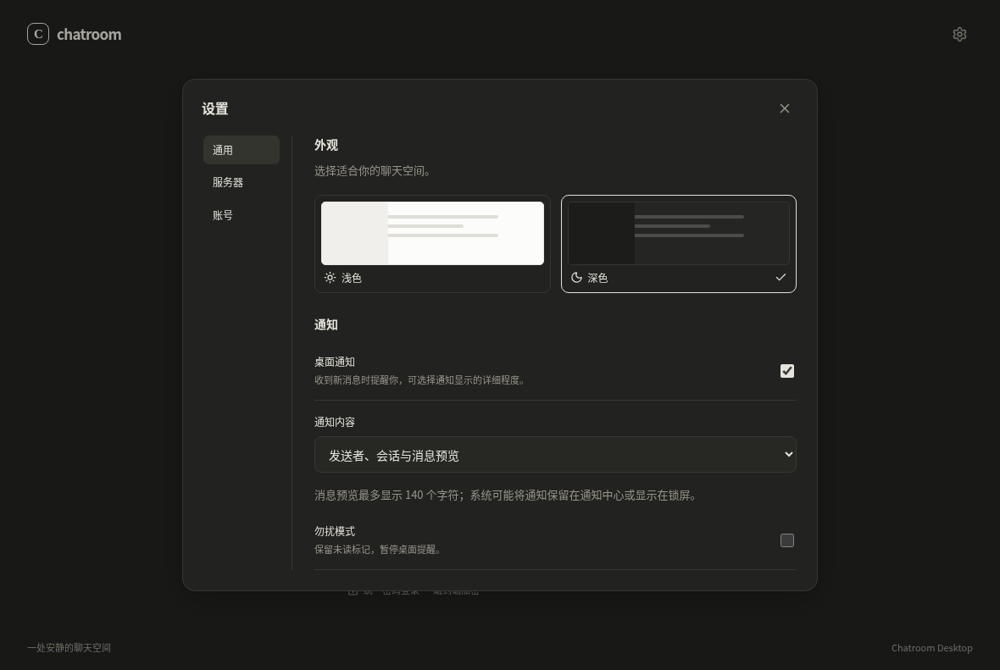

# Electron 桌面客户端

v2.0.3 沿用自 v2.0.2 引入的 Electron + React + TypeScript + Vite，替换旧 Tkinter 桌面界面。视觉参考 Codex Desktop 的低对比侧栏、宽松消息排版和底部输入区。通信与加密暂时复用独立 Python 核心。

普通用户从 [v2.0.3 发布页](https://github.com/starryuchuu/chatroom/releases/tag/v2.0.3) 下载 Windows / Linux x64 桌面 ZIP，完整解压后运行 `chatroom.exe` / `./chatroom`，无需安装 Python 或 Node.js。升级时关闭旧客户端并保留原配置和独立离线密钥备份；新核心沿用原本机配置与密钥库。先处理旧进程的待确认发送，草稿不跨进程保存。

## 源码运行

需要 Node.js 24、Python 3.11+。在仓库根目录开始：

```bash
python -m pip install -r requirements.txt
cd desktop
npm ci
npm start
```

`npm start` 编译并启动 Electron；`npm run dev` 启用本机 Vite 开发服务器。开发模式默认调用 `python3`（Windows 为 `python`）；使用虚拟环境时先激活环境，或将 `CHATROOM_PYTHON` 设置为解释器的绝对路径。根目录的 `python client.py` 将当前解释器传给 Electron。

首次启动可能下载 Electron 运行时。通过代理联网的 Node.js 24 环境可设置 `NODE_USE_ENV_PROXY=1`，保留代理和受信任 CA 配置。

默认服务器仍为本机 Python 12345 / Go 12346。登录页右上角进入「设置 → 服务器」管理地址、端口和经核实的公钥指纹。远程连接必须固定服务器指纹，连接 / 认证 / 重连期间禁止切换配置。

## 界面入口

- 登录页切换创建账号；「恢复与迁移」提供离线备份导入、旧账号迁移和旧密钥解锁。
- 侧栏按全部 / 好友 / 群聊筛选，点击「新的对话」添加好友或创建群聊。
- 左侧栏底部「在线用户」显示当前服务器在线人数，点击查看和搜索用户名；人数包含自己，列表随服务器推送更新。断线时明确显示为上次列表，避免误报在线。
- Enter 发送，Shift / Ctrl / Command + Enter 换行。中文输入法预编辑 Enter 不触发发送。
- 别人的消息和头像在左侧，自己的消息和头像在右侧；采用灰阶圆角气泡，时间位于气泡下方，长消息在各自区域内换行。
- Ctrl / Command + F 搜索当前会话已加载且通过验证的正文；搜索、草稿和正文只在内存中保留。
- 消息支持原生文本选择；消息操作可复制全文、查看原始时间和保护状态。
- 阅读历史时不跟随收到的消息；点击「回到最新」返回底部，缓存淘汰时重新请求最新历史。
- 「加密与密钥」显示身份指纹，提供联系人核验、新密钥确认、离线备份、改密和群接收人核验。
- 「更多 → 待确认消息」逐条核对原结果。服务器确认无回执后允许显式重试；移除本机记录需要确认，不撤回服务器消息。
- 深浅主题在设置或聊天页右上角切换，写入原配置文件；退出不删除加密密钥库。

## 桌面通知

「设置 → 通用 → 通知内容」提供三档：仅提示有新消息、发送者与会话名称（默认）、发送者与消息预览。旧配置没有此选项时默认显示发送者与会话，不自动展示正文。开启消息预览后，私聊显示发送者和摘要；群聊显示群名、发送者和摘要。摘要压成单行、最多 140 个字符；未通过安全验证的内容不会显示正文。

仅对实时、未读的他人消息提醒；历史、断线补取、自己的消息，以及正在前台查看的会话底部不弹通知。关闭桌面通知或开启勿扰仍保留未读数。通知间隔至少一秒。点击通知会恢复并聚焦窗口、打开对应会话，保留原会话未发送草稿；退出账号、移除会话或改变通知内容设置后，旧通知不能跳转。

Windows 主进程设置与打包配置相同的 AppUserModelID：`io.github.starryuchuu.chatroom`。ZIP 便携版首次运行时自动创建当前用户的「Chatroom Desktop」开始菜单快捷方式，包含同一标识；移动解压目录后再次启动会更新快捷方式目标，不需要管理员权限。开发运行不创建快捷方式。注册或通知调用失败时在界面内提示。

正文预览会交给操作系统，可能保留在通知中心或出现在锁屏；系统自己的通知权限、勿扰和锁屏设置仍然生效。客户端设置文件只保存预览档位，不保存正文。关闭主窗口会退出程序；当前没有托盘常驻、关闭后的后台推送或从已退出程序恢复会话的通知激活功能。

自动测试覆盖实际加密消息到 Electron 通知接口、点击跳转与草稿保留；Windows 成品测试会读取开始菜单快捷方式核对目标和 AppUserModelID。Linux 本地测试替代原生弹出调用，不能代替 Windows 通知横幅、通知中心及锁屏的人工验收。




以上为真实 Electron 内容区截图，使用虚构展示数据，不包含系统标题栏。

## 打包

在目标系统构建核心，再打包桌面：

```bash
python -m pip install -r requirements-build.txt
pyinstaller --onefile --console --exclude-module tkinter --collect-submodules Crypto.PublicKey --collect-all wasmtime --additional-hooks-dir hooks --add-data "chatroom_client/opaque_core.wasm:chatroom_client" --distpath desktop/core-dist --clean --name chatroom-core core_client.py
cd desktop
npm ci
npm run dist
```

`release/` 输出 Windows / Linux ZIP，内含 Electron 和核心，用户无需安装 Python / Node.js。Windows 解压后运行 `chatroom.exe`；Linux 运行 `./chatroom`。Windows / Linux CI 均检查实际打包客户端。macOS 配置已提供，当前流水线尚不构建 macOS 客户端。

新入口和核心不导入 Tk，桌面分发包不包含旧视图。旧 Tk 源码与测试暂留仓库，作为迁移期间的历史回归基准。

发布隐私检查允许更大的单一归档成员以容纳 Electron，但保持总展开预算。Electron 45.0.0 Linux / Windows x64 官方二进制包含公开构建路径，官方 ZIP 使用固定 npm 包内的校验值验证。只有完全匹配已核验文件 SHA-256 的原始字节，或 Windows PE 中完全匹配已核验 `.rdata` 段 SHA-256 的字节区域，才可识别为上游构建路径；不扩大通用用户名白名单。

Windows 打包器会写入 ASAR 完整性资源，改变整个 EXE 的哈希，但不改动上述 `.rdata` 原始字节。检查只对完整位于已核验区域内的路径匹配应用豁免；新增资源、其他段和尾部附加数据继续扫描。显式禁止值、密钥及凭据检查仍覆盖全部字节。修改 `.rdata` 中任一字节就失去对应信任，畸形 PE 或越界段不会取得豁免。

Windows 设置 `signAndEditExecutable: false`，不额外修改图标、版本资源或签名，打包器仍保留 ASAR 完整性资源。Chatroom 版本来自应用包的 `package.json`。升级 Electron 时必须重新核验官方归档及相应字节区域。Windows 资源注入后的打包目录已在 Linux 交叉构建复现隐私检查；这不替代原生 Windows 的启动及成品测试。

## 验证

```bash
# 根目录：真实服务端上的双核心 E2EE 测试
python -m unittest discover -s tests -p test_desktop_rpc.py -v
# 设置 CHATROOM_GO_SERVER_EXE 可同时覆盖 Go 服务端
cd desktop
npm run build
npm test
# Linux 无显示环境：xvfb-run -a npm test
```

`CHATROOM_DESKTOP_EXECUTABLE` 指向解包客户端的绝对路径时，同一 Playwright 套件检查打包产物。渲染测试使用隔离配置与虚构数据；真实中文输入法候选窗口和预编辑体验仍需目标系统人工验证。

## 发布

日常推送只运行受改动影响的检查；完整跨平台测试和成品打包仅在正式标签发布时执行。在干净且包含发布说明的 `master` 上运行 `python scripts/release.py <新版本>`，或加 `--dry-run` 预览。步骤及失败重试见[贡献指南](../CONTRIBUTING.md)。

## Rust 替换边界

Electron 只启动核心并转发 JSON-RPC，不调用 Python 模块。未来 Rust 核心实现 [Desktop Protocol v1](DESKTOP_PROTOCOL.md) 和 [`protocol.ts`](../desktop/src/protocol.ts) 后，可替换相同位置的核心程序，复用全部界面。

替换时保持账号 / socket / 群代次、确认上下文、密钥库兼容与发送幂等语义，并运行相同的 Python / Go 服务端互操作测试。本次 UI 迁移不修改服务器线协议和加密格式。
